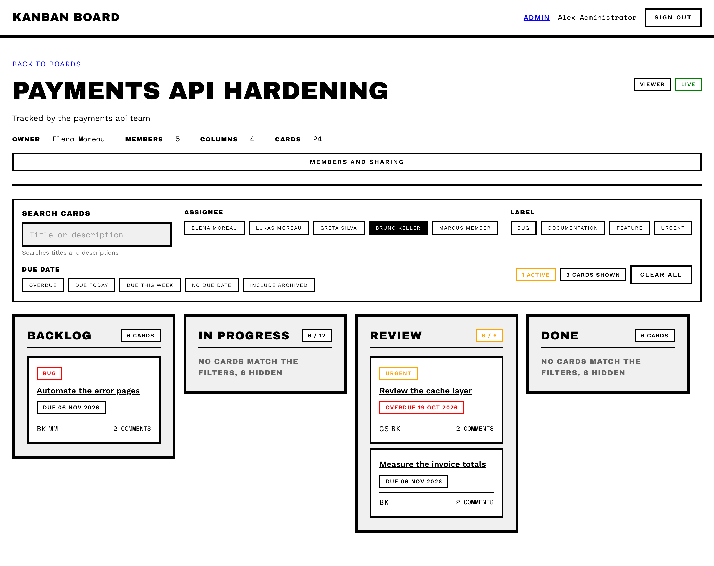
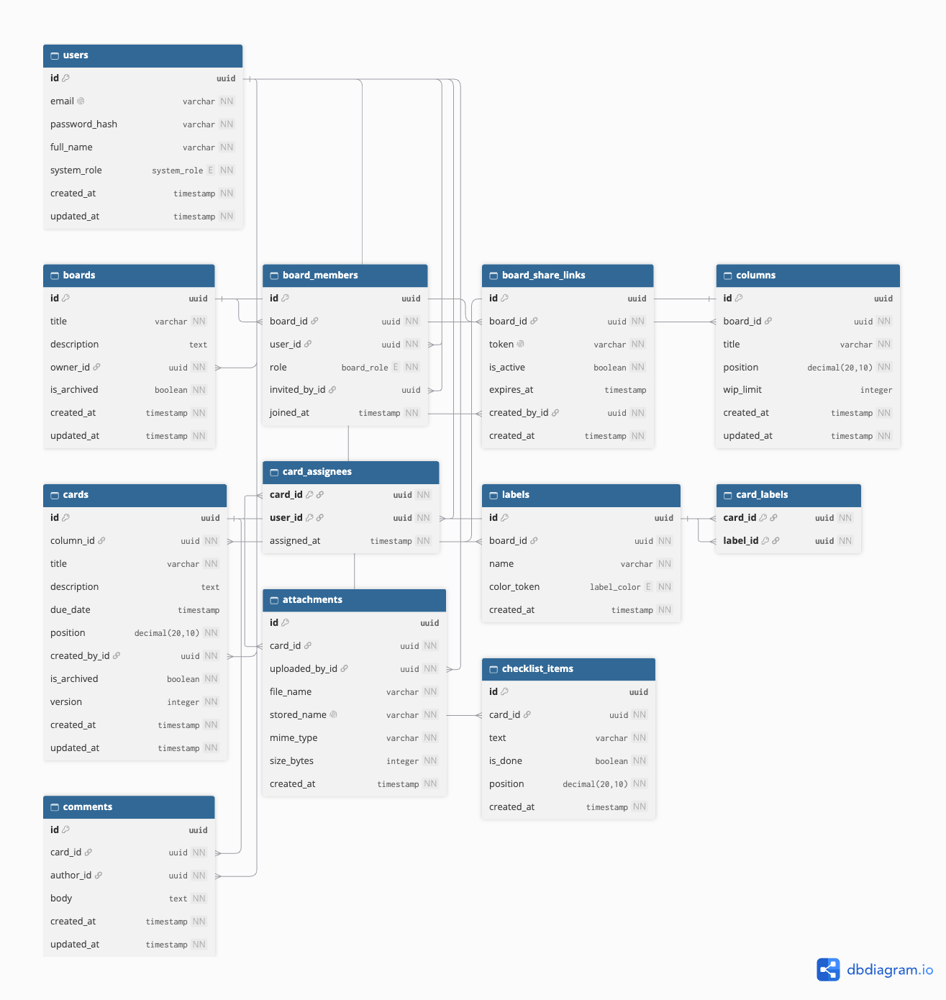
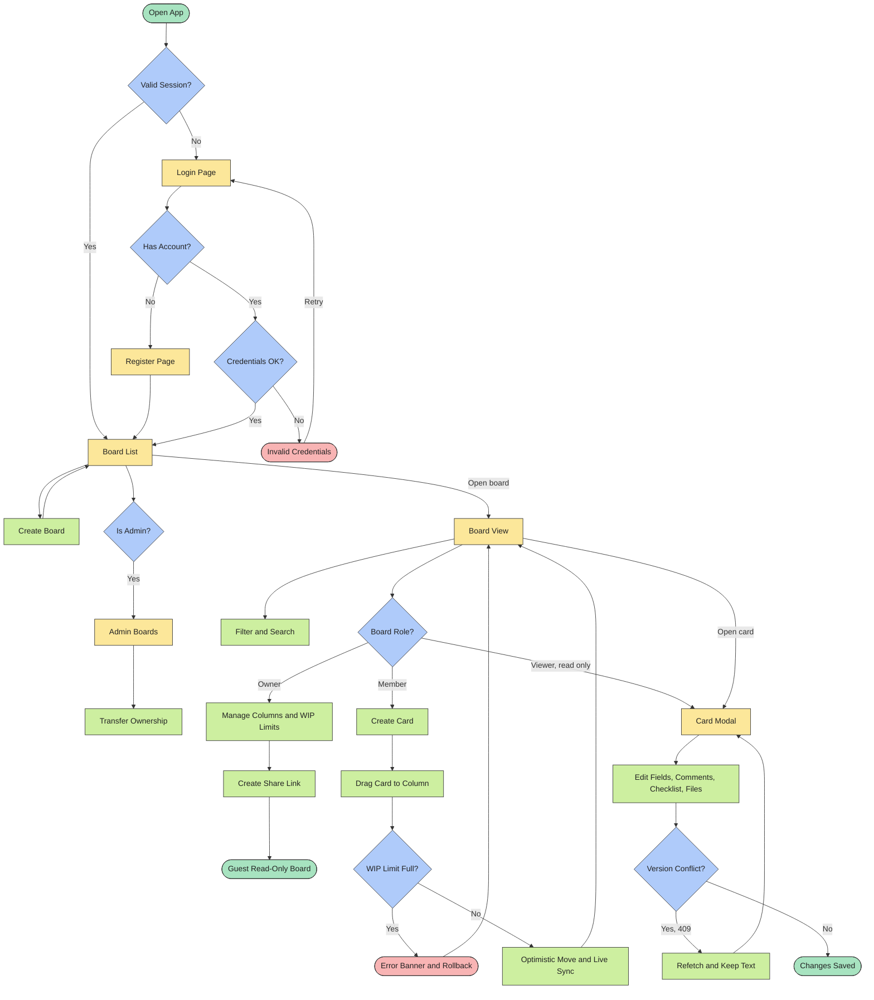

# Kanban Board University Project 🎓

A team Kanban board with drag-and-drop columns and cards, role-based access and a card order that stays consistent when several people move cards into the same slot at once.

---



---

## Features

- Boards with columns and cards, dragged with `@dnd-kit` (pointer and keyboard)
- Consistent card order under concurrent moves: neighbour-based fractional positions resolved in a `SERIALIZABLE` transaction
- Optimistic moves with rollback when the server refuses
- Realtime board sync over Socket.IO
- Email/password authentication (JWT in an httpOnly cookie)
- Board roles (`OWNER` / `MEMBER` / `VIEWER`) and system roles (`USER` / `ADMIN`)
- Read-only guest access by share link
- Per-column WIP limit enforced on card create and move
- Card details: description, due date, assignees, labels, checklist, comments, attachments
- Filter by assignee, label and due date, plus card search
- Stale-edit detection with `409` on a conflicting card save
- Admin board overview with ownership transfer

## Tech stack
- React 19, TypeScript, Vite
- TanStack Query, Zustand, `@dnd-kit`, `socket.io-client`
- Node.js 20+, Express 5, Prisma 7, PostgreSQL 16
- Docker
- Vitest, Supertest, ESLint, Prettier

## How to Run Locally

### Prerequisites

- Node.js 20+
- Docker

### 1. Install dependencies

```bash
npm install
cd backend && npm install
```

### 2. Configure environment variables

Copy the example files and fill in the values:

```bash
cp .env.example .env
cp backend/.env.example backend/.env
```

### 3. Start the database

```bash
docker compose up -d
```

This starts a PostgreSQL container on host port `5433`. Database credentials live in `docker-compose.yml` — if you change them there, change `DATABASE_URL` in `backend/.env` to match.

### 4. Apply migrations and seed

```bash
cd backend && npm run db:reset
```

Applies all Prisma migrations and seeds 60 users, 30 boards, 120 columns, 800 cards and 1500 comments. This wipes the database; use `npm run db:migrate` to keep existing data.

Seeded accounts, all with the password `Password123!`: `admin@kanban.test`, `owner@kanban.test`, `member@kanban.test`.

### 5. Run the app

```bash
# backend
cd backend && npm run dev

# frontend (in a separate terminal, from project root)
npm run dev
```

Frontend runs on `http://localhost:5173`, backend on `http://localhost:4000`.


### DataBase Structure

Here the database structure visualization via https://dbdiagram.io/d using DBML.

---



---

### User Flow Diagram

Here the user flow visualization via mermaid diagram.

---


---

## 🎉 Join my Telegram Channel!

[Join Telegram](https://t.me/drzoidberg_portfolio)

Enjoy and happy coding! 🚀
